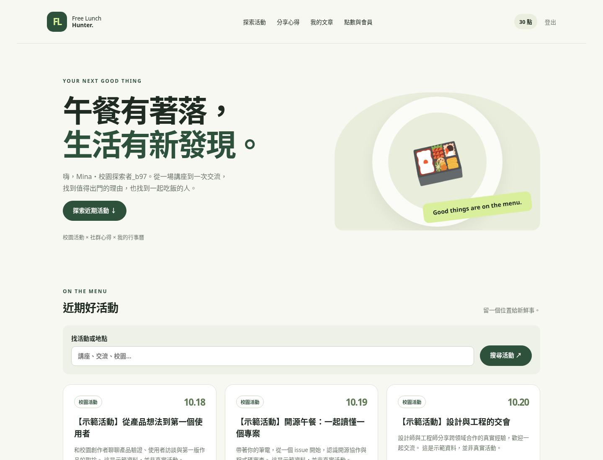

# Free Lunch Hunter

A campus event community with a transactional points wallet and membership ordering flow. Discover events, save a personal schedule, publish reviews, and earn community points. Spend 30 points on a one-time Premium upgrade, with a receipt and an auditable wallet entry.

The backend emphasizes the parts of commerce that must remain correct when requests fail or arrive concurrently: authentication, authorization, retry semantics, balance updates, and order consistency. **Community points have no cash value. No real payment processing is implemented.**

## What to review

- **Transactional membership orders:** the order, wallet debit, and membership entitlement commit together. The wallet row is locked before checking balance or changing state.
- **Safe retries:** an idempotency key is scoped to the authenticated account. Concurrent retries return the original order; competing new requests cannot purchase an already-owned membership.
- **Wallet audit trail:** rewards and debits have unique event references. Repeated vote changes cannot farm rewards. The test suite reconciles wallet balances against the ledger.
- **Operational reconciliation:** a read-only CLI checks balances, order debits, missing wallets, and membership entitlements using exact database decimals. It reports drift and unavailable checks with distinct exit codes.
- **Consistent wallet reads:** the API and wallet page read balances, entries, and receipts from one committed snapshot, including when another session completes a transaction.
- **Explicit access boundaries:** public registration always creates a regular member. Administrator access is granted through a CLI command. Article and activity writes check ownership.
- **Defensive HTTP handling:** CSRF protection on every mutation, regenerated login sessions, prepared statements, escaped output, validated uploads, and correlated errors without SQL details.
- **Reproducibility:** a versioned, checksummed schema, Docker Compose, a JSON API contract, and a real MariaDB/HTTP regression suite with concurrent requests and injected storage failure.

PHP 8.4 · MariaDB 11.8 · vanilla JavaScript · Python standard-library tests. The browser UI uses local assets and works without third-party CDNs.



[Membership receipt and wallet](docs/screenshots/wallet.png) · [Mobile view](docs/screenshots/mobile.png) · [Validation record](docs/validation.md)

## Run locally

Requirements: Docker Engine and Docker Compose v2.

```bash
cp .env.example .env
# Edit .env: choose separate local DB and root passwords.
docker compose up -d --build
docker compose ps
```

Open `http://localhost:8080`. Compose waits for MariaDB, applies the schema, then starts the web service. Change `APP_PORT` if 8080 is occupied. Database and uploaded images persist in named volumes. The database has no host port mapping.

Register an account through the UI. To grant that account administrator access and add clearly labeled sample events:

```bash
docker compose exec app php scripts/admin.php your-registered-email@example.com
docker compose exec app php scripts/seed.php
```

`seed.php` preserves existing content and does not create a known-password account. It can be run repeatedly without duplicating its events. To demonstrate the upgrade without earning points manually, set `ENABLE_DEMO_TOPUP=1` in `.env` and run `docker compose up -d`. The wallet page will show a **demo-only** credit form. It is disabled by default and is not a payment integration.

Stop services with `docker compose down`. Only use `docker compose down -v` when intentionally deleting the development database and uploads.

### Without Docker

Use PHP 8.4 with `pdo_mysql` and `fileinfo`, and an empty MariaDB 11.8 database. Set `DB_DSN`, `DB_USERNAME`, and `DB_PASSWORD` in the process environment:

```bash
export DB_DSN='mysql:host=127.0.0.1;dbname=free_lunch_hunter;charset=utf8mb4'
export DB_USERNAME=hunter
# Supply DB_PASSWORD through your local environment; never commit it.
php scripts/migrate.php
php -S 127.0.0.1:8080 -t final_project
```

Configuration comes from environment variables; PHP does not load `.env` itself. `APP_TIMEZONE` defaults to `Asia/Taipei`. Use an empty database for this revision: the migration intentionally refuses to adopt an unversioned legacy schema. See [migration notes](docs/architecture.md#schema-and-existing-data).

## Validate the backend

Requires PHP, Node.js for JavaScript syntax checking, Python 3.10+, and a dedicated MariaDB database whose name ends in `_test`. The database user must be able to create tables and test-only triggers. The runner refuses other database names.

```bash
sh scripts/lint.sh
export DB_DSN='mysql:host=127.0.0.1;dbname=free_lunch_hunter_test;charset=utf8mb4'
# Set DB_USERNAME and DB_PASSWORD for that isolated database.
python3 tests/integration.py
```

The suite starts a four-worker PHP server on a free loopback port, applies migrations twice, creates unique fixtures, and removes its own accounts with foreign-key cascades. It uses separate login sessions for concurrent requests so PHP session locking cannot hide database races. Coverage includes role escalation, CSRF, cross-account edits, duplicate votes, wallet retry conflicts, insufficient balance, transaction rollback, concurrent membership purchases, and ledger reconciliation. There is no browser or external service dependency in this suite.

Reconciliation tests deliberately introduce a 0.01-point difference, a balanced but incorrect order debit, an orphan debit, a missing wallet, and an unearned entitlement. A separate test pauses a read snapshot while another authenticated session commits a credit, then verifies that both reads still describe the original committed state.

[GitHub Actions](.github/workflows/ci.yml) runs syntax checks and the same suite against case-sensitive MariaDB defaults. Check the pull request's workflow runs for hosted results; the [validation record](docs/validation.md) distinguishes local checks from hosted evidence.

### Check a running installation

```bash
docker compose exec -T app php scripts/reconcile.php
# Optional: limit an investigation to one internal account ID.
docker compose exec -T app php scripts/reconcile.php --user-id=123
```

The command returns JSON and exits **0** for clean data, **1** for detected inconsistencies, or **2** if the check could not run. It never repairs records or prints emails/passwords. See the [operations runbook](docs/operations.md) for the checks and response steps.

## Design and demonstration

- [Architecture and tradeoffs](docs/architecture.md)
- [OpenAPI contract](docs/openapi.yaml)
- [Reconciliation and operations](docs/operations.md)
- [Five-minute interview walkthrough and role alignment](docs/portfolio.md)
- [AI-assisted development and verification](docs/ai-development.md)

The frontend and API share the same service functions. `app/bootstrap.php` owns HTTP/session boundaries; `app/services.php` owns domain transactions; `app/view.php` contains shared presentation helpers. `final_project/` is the only intended web document root. The original `/final_project/*.php` URLs also work when serving the checkout root for local development, but exposing the full checkout is not the container's configuration.

This project originated as a campus course-team application; the original repository credits Great Purpose Team. This revision keeps its event/community concept while replacing duplicated page logic with shared services and adding testable commerce behavior. It does not claim production traffic, payment-provider integration, or measured business impact.
