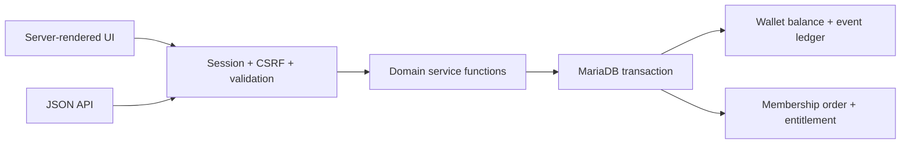

# Architecture and reliability decisions

## Request path

The small PHP application deliberately uses one service layer for both forms and API calls. There is no separate implementation of purchase semantics in a controller or JavaScript bundle. A single relational transaction is sufficient for the current scope; introducing a queue, cache, or distributed service would add failure modes without solving a current requirement.

## Membership ordering

1. Authenticate the caller, verify CSRF, and validate the fixed product and idempotency key.
2. Begin a transaction and lock the caller's `premium` wallet row with `SELECT … FOR UPDATE`.
3. Look up `(user_id, idempotency_key)`. An existing matching order is returned with `replayed=true`, even though its membership is now active.
4. For a new order, require regular-member status and at least 30 points.
5. Insert a completed order, append a negative wallet entry, update the balance, and activate Premium in one transaction.
6. Commit. A failure at any prior step rolls back all changes.

The row lock serializes purchases for the same wallet. Different keys do not bypass the entitlement check. A unique database key on the request provides a second boundary. The price and product are server-controlled; clients never supply a debit amount. Amounts are exact `DECIMAL(12,2)` in MariaDB; current business operations use integer points, with no currency conversion or floating-point arithmetic in balance updates.

This is a **synchronous points redemption**, not a payment checkout. The order has only a completed state because no external payment is authorized or captured. A real payment integration would need pending/failed/refunded states, verified webhooks, provider-scoped event deduplication, and an outbox or equivalent delivery mechanism. Those are future requirements, not implemented capabilities.

## Ledger and rewards

`premium.money` is the materialized balance. `wallet_entries` records positive rewards and membership debits. Both change in the same transaction, after locking the wallet row. `(user_id, action, reference)` prevents duplicate events.

- Publication: +5, reference = article ID.
- Comment: +3, reference = comment ID.
- First nonzero vote: +1, reference = article ID. Changing or deleting that vote never grants another reward.
- Membership: −30, reference = order ID.
- Optional sandbox credit: an explicitly enabled demo operation, with an idempotency key and amount-conflict detection.

Voting sets a desired state (`-1`, `0`, `1`); repeating the state does nothing. The article row is locked before applying its score delta, so concurrent voters cannot lose score updates. Lock order for reward-bearing operations is wallet first, then article. Wallet history is append-only through application services. Deleting an article does not erase its historical reward events or reverse earned points; these are the current product rules.

The suite verifies `SUM(wallet_entries.amount) = premium.money` for every fixture account. An application bug or manual SQL could still break that invariant. A production system should add periodic reconciliation, restricted database grants, fraud controls, and administrative adjustments with their own events. There is no claim of financial-grade accounting here.

## HTTP and data boundaries

- Public registration ignores role input; a trusted CLI grants administrator rights.
- Login regenerates the session ID. Cookies are HttpOnly and SameSite=Lax, and Secure when served over HTTPS.
- Every state change requires POST and a session CSRF token, including logout and login. JSON writes accept `X-CSRF-Token`.
- Session-cookie authentication is intended for the same-origin browser application. This is not yet a partner API with OAuth or machine credentials.
- SQL uses native prepared statements. Dynamic sort clauses come only from fixed allowlists.
- Output uses HTML escaping. Link protocols are restricted. There is no inline JavaScript or external script dependency.
- Uploaded images require real image content, an allowed MIME type, a 2 MB size limit, and bounded pixel dimensions. Random file names prevent overwrites. Failed publication removes its newly stored file.
- Errors expose a safe message and request ID; logs contain the ID, status, and exception class, not SQL values, credentials, or request bodies.

The application still needs login throttling, password recovery, moderation, upload lifecycle cleanup, monitoring, and operational hardening before public production use. The PHP built-in server is a reproducible development/demo server; use a maintained PHP-FPM/reverse-proxy setup with HTTPS for deployment.

## Schema and existing data

`scripts/migrate.php` initializes an empty database with nine application tables and a checksummed migration record. It uses a named database lock, detects modified applied SQL, and is safe to rerun. MariaDB DDL commits implicitly; the initial table definitions use `IF NOT EXISTS` so an interrupted initialization can resume. Later changes must be separate numbered migrations rather than modifications to an applied schema.

The original repository contained neither SQL migrations nor a database export. The new schema is derived from its queries and tightened with foreign keys, unique keys, schedule indexes, and check constraints. All table identifiers are lowercase; no Windows-style case-insensitive setting is required. The CI configuration checks this explicitly.

An unversioned existing database is intentionally rejected before creating application tables. Preserve/export it first, inspect case variants and orphan records, map accounts and balances, and write a reviewed import migration. Every imported nonzero balance needs an opening ledger entry. The current migration does **not** silently alter or reset legacy data. The onboarding database, if present outside the checkout, remains separate.

## Evidence and limits

The regression suite exercises actual HTTP requests and actual MariaDB transactions. Its storage-failure test installs a temporary trigger only in an isolated `_test` database, causes a membership ledger insert to fail, and verifies that no order, debit, or entitlement survives. Concurrent tests use four PHP worker processes and four independently authenticated sessions.

The tests demonstrate correctness for these selected workflows. They are not a load benchmark, penetration test, uptime measurement, or proof of distributed exactly-once delivery. APAC timezone and currency requirements would need explicit product decisions: this demo uses Asia/Taipei presentation time and a single nonmonetary points unit.
